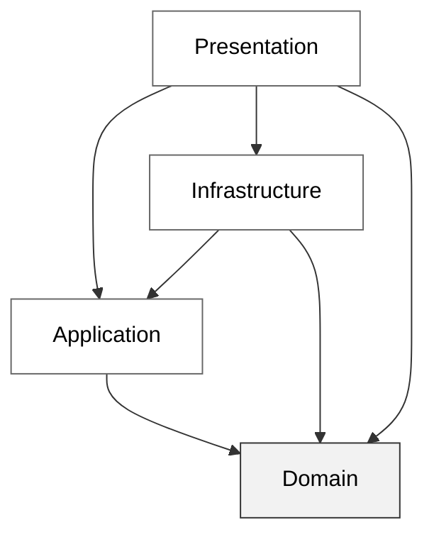

Grupparbete av: *Ali, Erik och Anton.*
---

# Support Desk

Support Desk är ett ärendehanteringssystem byggt i WinUI för att koppla support tickets till kunder och handledare. Detta för att underlätta för företagets support avdelning och veta hur de ska planera sitt arbete utifrån nya, pågående och avklarade ärenden.

## Använd programmet

För att köra programmet:
- Klona eller ladda ner develop branchen.
- Sätt SupportDesk.Presentation som startup project.
- Kör projektet.

---
## Projektets struktur

| Proejt | Ansvarsområde |
|:-----|:------|
| Domain | I Domain projektet har vi samlat projektets modeller [*Customer, SupportTicket, TicketStatus* etc.] samt Value objects som modellerna använder [***Email, TicketDescription, CommentText*** etc.]  |
| Application  | I Application projektet så har vi våra Services och Interfaces [***CommentService, ITicketService, TicketService*** etc.] |
| Infrastructure | Infrastucture består av våra repositories samt datamodeller för den data som sparas i våra repositories [***JsonCustomerRepository, TicketData*** etc.]  |
| Presentation  | Presentationlagret är ett WinUi projekt som innehåller vår Nagigering, ViewModels och Pages [***CustomerPage, NavigationService*** etc.]  |
| Test  | Xunit projekt som innehåller tester för Domain, Application och Infrastructure projektet  |

### Beroendetabell mellan projekten

## Datalagring

Datan för kunder, support-tickets och kommentarer sparas i .json filer.
filerna sparas i:  
`AppData\Local\Packages\[PFN]\LocalCache\Local\SupportDesk`  
där PFN (Package Family Name) som är ett unikt ID för installationen av applikationen och företaget som publicerat den.

## Arbetsfördelning
Då vi valde att bryta ner arbetet till mindre delar så har vi alla varit lite delaktiga i det mesta, men nedan följer en lite mer ingående uppdelning på fokusområden.

### Ali

#### Backend
- Value Objects för SupportTickets och kommentarer
- Registrering och uppdatering av SupportTickets
- Lägga till och visa kommentarer
- JSON-repository för kommentarer
- Lagt till enhetstester för kommentarshantering

#### Frontend
- Dashboard-vyn
- Statistik över nya, pågående och avslutade ärenden
- Procentberäkning för ärendestatus
- Koppling mellan Dashboard och ViewModel

### Erik
#### Backend
- Kundregistrering och JSON-lagring för kunder
- Funktionalitet för att hämta och uppdatera kunder
- Sökning efter ärenden på rubrik och kundnamn
- Kombinerad sökning och statusfiltrering
- Kommentarshantering kopplad till handläggare
- Validering av status och prioritet

#### Frontend
- Grundstruktur för GUI och navigation
- Registreringsvy för ärenden
- TicketsPageViewModel
- Detaljvy för ärenden
- Tilldelning av handläggare och kund
- Visning och registrering av kommentarer
- Visning av kommentarernas tid i lokal tid

### Anton
#### Backend
- Value Objects för Customer 
- JSON settingsfil
- Tilldela Customer till SupportTicket
- Tilldela Handledare till en SupportTicket
- Filtrera Tickets efter status
- Lagt till tester enhet och integration

#### Frontend
- Customer vyn
- InfoBar som visar olika typer av info och felmeddelanden
- Lagt till så att kunddropdown blir inaktiv när inga kunder finns inlaggda.

## Resultat av manuell kontroll
Applikationen har gåtts igenom manuellt efter att funktionerna färdigställts.

Följande kontrollerades:

- Applikationen kan startas och navigering mellan Översikt, Ärenden och Kunder fungerar.
- En ny kund kan registreras med namn och giltig e-postadress.
- Befintliga kunder kan visas och uppdateras.
- Ett nytt ärende kan registreras och kopplas till en kund.
- Ärenden kan sökas på rubrik och kund samt filtreras på status.
- Sökning och statusfilter kan kombineras.
- Ett ärende kan öppnas i detaljvyn.
- Titel, beskrivning, kund, prioritet, handläggare och status kan uppdateras.
- Ett ärende kan inte ändras till Pågående eller Löst utan tilldelad handläggare.
- Kommentarer kan läggas till och kopplas till den valda handläggaren.
- Kommentarer visas i kronologisk ordning och med lokal tid.
- Dashboarden visar totalt antal ärenden samt antal Nya, Pågående och Lösta ärenden.
- Dashboardens värden uppdateras när ett ärendes status ändras.
- Kunder, ärenden och kommentarer finns kvar efter att applikationen startats om.
- Applikationen kan starta även om JSON-filerna ännu inte finns.
- Felaktig JSON skrivs inte över med tom data vid misslyckad inläsning.
- Validerings- och felmeddelanden visas i gränssnittet vid ogiltig inmatning eller misslyckade operationer.

Den manuella kontrollen genomfördes tillsammans med de automatiserade enhets- och integrationstesterna.

## Ai användning i projektet
AI-verktyg har använts som stöd under projektet, främst för förklaringar, felsökning, kodförslag och hjälp med att resonera kring lösningar.

Förslag från AI har inte tagits in utan kontroll. Vi har granskat koden, anpassat den till projektets struktur och testat funktionerna både 
manuellt och med automatiserade tester innan ändringar har mergeats.

AI har bland annat använts för att diskutera validering, JSON-lagring, tester och felhantering