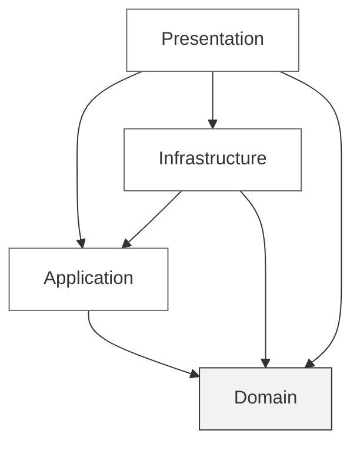

Grupparbete av: *Ali, Erik och Anton.*
---

# Support Desk

Support Desk är ett ärendehanteringssystem byggt i WinUI för att koppla support tickets till kunder och handledare. Detta för att underlätta för företagets support avdelning och veta hur de ska planera sitt arbete utifrån nya, pågående och avklarade ärenden.

## Använd programmet

För att köra programmet:
- Klona eller ladda ner develop branchen.
- Sätt SupportDesk.Presentation som startup project.
- Kör projektet.

---
## Projektets struktur

| Proejt | Ansvarsområde |
|:-----|:------|
| Domain | I Domain projektet har vi samlat projektets modeller [*Customer, SupportTicket, TicketStatus* etc.] samt Value objects som modellerna använder [***Email, TicketDescription, CommentText*** etc.]  |
| Application  | I Application projektet så har vi våra Services och Interfaces [***CommentService, ITicketService, TicketService*** etc.] |
| Infrastructure | Infrastucture består av våra repositories samt datamodeller för den data som sparas i våra repositories [***JsonCustomerRepository, TicketData*** etc.]  |
| Presentation  | Presentationlagret är ett WinUi projekt som innehåller vår Nagigering, ViewModels och Pages [***CustomerPage, NavigationService*** etc.]  |
| Test  | Xunit projekt som innehåller tester för Domain, Application och Infrastructure projektet  |

### Beroendetabell mellan projekten

